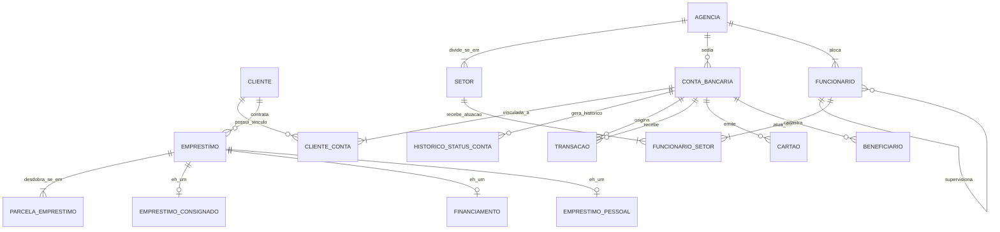

# Modelo Entidade-Relacionamento Conceitual (MER) — Versão Revisada (C1)

## 1. Notação e Padrão Adotado
Adotou-se a notação de **Engenharia da Informação (Crow's Foot)** de forma unificada e consistente em todo o modelo, com explicitação rigorosa das **cardinalidades mínimas e máximas** `(min, max)` em cada uma das pontas dos relacionamentos.

---

## 2. Diagrama Conceitual (Mermaid ER)

---

## 3. Especificação das Cardinalidades Mínimas e Máximas

1. **CLIENTE (1,1) --- [Vínculo] --- (0,N) CONTA_BANCARIA**:
   - Um cliente pode não possuir contas no momento do cadastro ou possuir várias (0,N).
   - Toda conta bancária obrigatoriamente pertence a pelo menos um cliente titular e pode ter co-titulares (1,N). Mapeado via tabela associativa `CLIENTE_CONTA` com atributos próprios (`tipo_titular`, `data_vinculo`).
2. **AGENCIA (1,1) --- [Alocação] --- (1,N) FUNCIONARIO**:
   - Uma agência possui 1 ou muitos funcionários alocados (1,N).
   - Todo funcionário é contratado e alocado em exatamente uma agência de lotação principal (1,1).
3. **FUNCIONARIO (0,1) --- [Supervisão] --- (0,N) FUNCIONARIO (Autorrelacionamento)**:
   - Um funcionário pode supervisionar 0 ou muitos outros funcionários (0,N).
   - Um funcionário subordinado possui 1 supervisor imediato (1,1), exceto os Gerentes Gerais que não possuem supervisor no nível de agência (0,1).
4. **FUNCIONARIO (1,N) --- [Vigência] --- (1,N) SETOR**:
   - Rastreamento histórico de lotação setorial através de `FUNCIONARIO_SETOR` com atributos próprios `data_inicio`, `data_fim` e `papel_desempenhado`.
5. **CONTA_BANCARIA (1,1) --- [Movimentação] --- (0,N) TRANSACAO**:
   - Uma conta pode não ter movimentações ou ter inúmeras transações (0,N).
   - Toda transação exige uma conta bancária de origem válida (1,1). O destino é obrigatório em transferências (1,1) e nulo em saques/pagamentos externos (0,1).
6. **EMPRESTIMO (1,1) --- [Parcelamento] --- (1,N) PARCELA_EMPRESTIMO (Entidade Fraca)**:
   - Todo contrato de empréstimo desdobra-se em pelo menos 1 parcela (1,N).
   - Uma parcela não existe sem o respectivo empréstimo contratado (1,1) e é identificada compostamente por `(id_emprestimo, numero_parcela)`.

---

## 4. Generalização / Especialização de Empréstimos (Totalidade e Exclusividade)

- **Classificação**: **Total e Disjunta / Exclusiva (t, d)**.
- **Justificativa Conceitual**:
  - **Totalidade (t)**: Não existe no sistema um empréstimo genérico. Todo empréstimo contratado enquadra-se obrigatoriamente em uma das três subclasses de crédito (`EMPRESTIMO_CONSIGNADO`, `FINANCIAMENTO` ou `EMPRESTIMO_PESSOAL`).
  - **Exclusividade (d)**: As categorias são mutuamente exclusivas; uma operação de crédito é ou um financiamento com garantia de bem, ou um consignado com retenção em folha de órgão público, ou um empréstimo pessoal com taxa pré-fixada. Uma mesma instância da superclasse não pode pertencer a mais de uma subclasse simultaneamente.

---

## 5. Tratamento de `HISTORICO_STATUS_CONTA` (Entidade Fraca por Dependência)

- **Decisão de Modelagem**: Atendendo à devolutiva C1, `HISTORICO_STATUS_CONTA` é formalizada como **entidade fraca (dependente por existência e identificação)** de `CONTA_BANCARIA`.
- **Justificativa**:
  - Uma alteração de status não possui significado isolado fora do ciclo de vida da conta à qual se refere.
  - Sua chave de identificação natural no domínio é composta por `(numero_conta, data_alteracao)`.
  - A integridade referencial foi definida com `ON DELETE RESTRICT` para garantir que o histórico contábil e regulatório de auditoria jamais seja destruído caso a conta seja encerrada.
