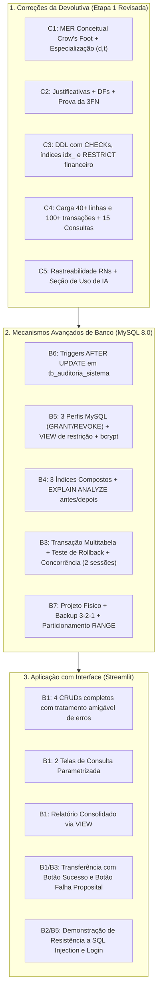

# Plano de Implementação Definitivo — Devolutiva Etapa 1 (C1 a C5) + Etapa 2 Completa (N2)

## [Goal Description]
Executar a entrega definitiva da disciplina **Laboratório de Banco de Dados** (UCB / Prof. Samuel Novais Moura Júnior), incorporando integralmente:
1. **A Devolutiva Oficial da Etapa 1 (Critérios C1 a C5)** recebida pelo professor;
2. **Todos os requisitos da Etapa 2 (N2 — Tópicos 6 a 9 e Anexo C)** do edital.

---

## Matriz de Ações da Devolutiva (C1 a C5)

| Critério | Apontamento da Devolutiva | Ação de Correção e Implementação |
|---|---|---|
| **C1** | MER do Workbench é físico; falta MER conceitual único com cardinalidades mín/máx explícitas, especialização de empréstimos com totalidade/exclusividade e tratamento de `historico_status_conta` | Criar diagrama conceitual com notação Crow's Foot unificada, cardinalidades mín/máx (0,1; 1,1; 0,N; 1,N), especialização total e exclusiva (d, t), e modelar formalmente `historico_status_conta` como entidade fraca dependente de `conta_bancaria`. |
| **C2** | Falta justificar especialização em 3 tabelas, chaves naturais vs substitutas e PK de `funcionario_setor`; sublinhar PKs e marcar FKs; demonstrar a 3FN com Dependências Funcionais (DFs) em vez de só afirmar | Documentar no relatório e em `docs/modelo_logico.md` as justificativas formais de design, esquemas com `<u>PK</u>` e `#FK`, e matriz exaustiva de DFs provando 1FN, 2FN e 3FN para todas as relações. |
| **C3** | Acrescentar índices `idx_`, CHECKs prometidos (cargo, tipo_titular, tipo de transação, modalidade) e comentários com as RNs; **corrigir ON DELETE CASCADE em dados financeiros** | Refatorar `sql/01_ddl.sql`: remover `CASCADE` de transações e histórico (adotar `RESTRICT` para integridade contábil), adicionar CHECKs e comentários com rastreamento a RN01..RN20. |
| **C4** | Carga fraca (4 clientes, 3 transações) — meta é **40 linhas nas principais e 100 na de maior movimento**; faltam casos de contorno; entregar as **15 consultas exigidas** com perguntas de negócio | Refatorar `sql/02_carga.sql` com 40+ clientes, contas, cartões, funcionários e 100+ transações com casos de borda (nulos opcionais, atrasos, bloqueios). Entregar as 15 consultas em `sql/03_consultas.sql` (5 básicas, 5 junções/agregação, 5 avançadas com correlacionada e EXISTS). |
| **C5** | Incluir tabela de rastreabilidade RN ➔ Implementação, declaração obrigatória de uso de IA, integrantes no relatório e estrutura no README | Incorporar no relatório técnico final (`docs/relatorio_etapa2.md`) e no `README.md` a tabela com as 20 regras, seção formal de IA (Tópico 9) e lista oficial de integrantes. |

---

## Matriz de Entregas da Etapa 2 (B1 a B8 + Tópicos 6 a 9)



---

## Proposed Changes Detalhado

### Componente 1: Correção do DDL, Cargas e Consultas (C3 e C4)

#### [MODIFY] [`sql/01_ddl.sql`](file:///home/guilherme-barcelos/Documentos/facu/banco/sql/01_ddl.sql)
1. **Remoção de CASCADE em Dados Financeiros**:
   - `fk_trans_origem` e `fk_trans_destino`: `ON DELETE RESTRICT ON UPDATE CASCADE` (preservação contábil).
   - `fk_hist_conta`: `ON DELETE RESTRICT ON UPDATE CASCADE`.
   - `fk_parc_emprestimo`: `ON DELETE RESTRICT ON UPDATE CASCADE`.
2. **CHECKs Obrigatórios**:
   - `ck_funcionario_cargo CHECK (cargo IN ('Gerente Geral', 'Gerente de Contas', 'Líder de Setor', 'Atendente', 'Analista de Crédito', 'Caixa'))`.
   - `ck_cliente_conta_tipo_titular CHECK (tipo_titular IN ('TITULAR', 'CO-TITULAR', 'AUTORIZADO'))`.
   - `ck_transacao_tipo CHECK (tipo IN ('PIX', 'TED', 'DOC', 'DEPOSITO', 'SAQUE', 'PAGAMENTO_BOLETO', 'TRANSFERENCIA'))`.
   - `ck_emprestimo_modalidade CHECK (tipo_modalidade IN ('CONSIGNADO', 'FINANCIAMENTO', 'PESSOAL'))`.
3. **Índices de Performance Iniciais**:
   - `idx_fk_cliente_conta_conta`, `idx_fk_trans_origem`, `idx_fk_trans_destino`, `idx_fk_parcela_emp`.
4. **Comentários de Rastreabilidade**:
   - Vínculo direto de cada tabela e restrição à regra de negócio correspondente (`-- RN01, RN02...`).

#### [MODIFY] [`sql/02_Cargas.sql`](file:///home/guilherme-barcelos/Documentos/facu/banco/sql/02_Cargas.sql)
- Inserção de dados plausíveis atendendo à meta do professor:
  - 40+ Clientes (pessoas físicas e jurídicas com CPFs/CNPJs formatados).
  - 40+ Contas Bancárias (Corrente e Poupança, distribuídas entre agências).
  - 40+ Vínculos em `cliente_conta` (com co-titulares e autorizados).
  - 40+ Cartões de Débito, Crédito e Múltiplo.
  - 40+ Parcelas de empréstimos em diversas modalidades.
  - **100+ Transações financeiras** com datas variadas, diferentes valores e tipos.
  - **Casos de contorno**: clientes com telefone em branco, parcelas com vencimento futuro e em atraso, contas bloqueadas, empréstimos em análise.

#### [MODIFY] [`sql/03_consultas.sql`](file:///home/guilherme-barcelos/Documentos/facu/banco/sql/03_consultas.sql)
15 consultas estruturadas e comentadas com sua respectiva pergunta de negócio:
- **5 Básicas**:
  1. Clientes pessoa física com busca textual (`LIKE`).
  2. Transações ocorridas em faixa de valores e datas (`BETWEEN`).
  3. Contas filtradas por múltiplos status (`IN ('ATIVA', 'BLOQUEADA')`).
  4. Identificação de supervisores ausentes ou contatos não cadastrados (`IS NULL`).
  5. Ordenação e paginação de clientes com projeção limpa.
- **5 Junções e Agregações**:
  6. Junção tripla: Cliente + Conta + Agência (visão completa da carteira).
  7. `LEFT JOIN`: Clientes sem nenhuma transação registrada até o momento.
  8. Total transacionado e quantidade de operações por agência (`GROUP BY` e `SUM`).
  9. Agências com volume transacionado acima da média (`HAVING SUM(valor) > ...`).
  10. Posição consolidada de dívida de empréstimos por cliente.
- **5 Avançadas**:
  11. Subconsulta correlacionada: Clientes cuja média de transação supera a média geral.
  12. Subconsulta com `EXISTS`: Contas que possuem pelo menos uma parcela em atraso.
  13. Subconsulta com `NOT EXISTS`: Contas ativas que nunca emitiram cartão de crédito.
  14. Consulta analítica de histórico de alterações de status de conta.
  15. Consulta de cálculo de rentabilidade e risco por modalidade de crédito.

---

### Componente 2: Scripts da Etapa 2 (B4, B5, B6, B7)

#### [NEW] [`sql/04_etapa2_seguranca_auditoria.sql`](file:///home/guilherme-barcelos/Documentos/facu/banco/sql/04_etapa2_seguranca_auditoria.sql)
1. **Tabela de Auditoria**: `tb_auditoria_sistema` com campos: `id_auditoria`, `tabela_afetada`, `operacao`, `usuario_responsavel`, `data_hora`, `valores_anteriores` (JSON), `valores_novos` (JSON).
2. **Gatilho 1 (Auditoria de Conta)**: `trg_audit_conta_bancaria` disparado `AFTER UPDATE` registrando transição de status (`ATIVA` ➔ `BLOQUEADA` / `ENCERRADA`) com `OLD` e `NEW`.
3. **Gatilho 2 (Auditoria de Parcela)**: `trg_audit_parcela_emprestimo` disparado `AFTER UPDATE` registrando quitações de parcelas.
4. **Visão de Relatório**: `vw_relatorio_consolidado_agencias` agrupando métricas por agência.
5. **Visão Restritiva de Perfil**: `vw_cliente_atendimento` mascarando CPF (`***.XXX.XXX-**`) e ocultando saldo global.
6. **3 Perfis MySQL com Menor Privilégio**:
   - `user_admin`: permissões totais.
   - `user_atendente`: `SELECT, INSERT, UPDATE` em `cliente`, `conta_bancaria`, `cartao` e `SELECT` em `vw_cliente_atendimento` (sem deletes e sem acesso a auditoria).
   - `user_auditor`: `SELECT` exclusivo em `tb_auditoria_sistema`, `historico_status_conta` e `transacao`.

#### [NEW] [`sql/05_etapa2_otimizacao_indices.sql`](file:///home/guilherme-barcelos/Documentos/facu/banco/sql/05_etapa2_otimizacao_indices.sql)
- 3 índices compostos justificados para o estudo de `EXPLAIN ANALYZE`:
  1. `idx_transacao_conta_data` em `transacao(numero_conta_origem, data_hora)`.
  2. `idx_parcela_status_vencimento` em `parcela_emprestimo(status, data_vencimento)`.
  3. `idx_historico_conta_data` em `historico_status_conta(numero_conta, data_alteracao)`.

---

### Componente 3: Aplicação Web Streamlit (B1, B2, B3)

#### [NEW] [`app/app.py`](file:///home/guilherme-barcelos/Documentos/facu/banco/app/app.py)
Interface gráfica moderna estruturada em 7 módulos:
1. **CRUD (4 Entidades)**: `Cliente`, `Conta Bancária`, `Cartão` e `Beneficiário` com formulários completos e tradutor de erros para mensagens amigáveis (ex: erro de CPF duplicado, saldo insuficiente, etc.).
2. **Consultas Parametrizadas**: Telas interativas com filtros de período, agência e titular com gráficos de agregação.
3. **Relatório Consolidado**: Painel executivo alimentado pela VIEW `vw_relatorio_consolidado_agencias`.
4. **Operação Transacional Multitabela**: Transferência entre contas com:
   - Botão **"Executar Transferência (Commit)"**
   - Botão **"Simular Falha Proposital no Meio da Transação (Rollback)"** demonstrando que o saldo permanece intocado.
5. **Segurança e Camada de Acesso**: Demonstração de Prepared Statements bloqueando `' OR '1'='1'`, login com senhas `bcrypt` e alternância entre perfis MySQL (`admin`, `atendente`, `auditor`).
6. **Benchmark & EXPLAIN**: Comparativo ao vivo do plano de execução antes e depois dos índices.
7. **Auditoria em Tempo Real**: Grid exibindo os logs capturados pelos triggers na `tb_auditoria_sistema`.

#### [NEW] [`app/db.py`](file:///home/guilherme-barcelos/Documentos/facu/banco/app/db.py)
- Pool de conexões MySQL, execução exclusiva com Prepared Statements e tradutor centralizado de exceções (`IntegrityError`, etc.).

#### [NEW] [`app/auth.py`](file:///home/guilherme-barcelos/Documentos/facu/banco/app/auth.py)
- Módulo de hash e verificação de senhas com `bcrypt`.

---

### Componente 4: Concorrência e Relatórios Técnicos (B3, B7, B8, C1, C2, C5)

#### [NEW] [`scripts/experimento_concorrencia.py`](file:///home/guilherme-barcelos/Documentos/facu/banco/scripts/experimento_concorrencia.py)
- Execução de 2 sessões simultâneas com `SELECT ... FOR UPDATE` disputando a mesma conta bancária, registrando bloqueio de linha, tempo de espera e nível de isolamento `REPEATABLE READ`.

#### [NEW] [`docs/relatorio_etapa2.md`](file:///home/guilherme-barcelos/Documentos/facu/banco/docs/relatorio_etapa2.md)
Documento final unificado reunindo:
1. **Etapa 1 Revisada (incorporando C1 a C5)**:
   - MER Conceitual revisado com cardinalidades mín/máx e especialização (d, t).
   - Justificativas formais de mapeamento, chaves substitutas/naturais e PK de `funcionario_setor`.
   - Prova formal da 3FN com lista exaustiva de Dependências Funcionais.
   - Tabela de rastreabilidade completa das 20 Regras de Negócio (RN01 a RN20).
2. **Etapa 2 (B1 a B7)**:
   - Evidências da aplicação, prepared statements e teste de injeção SQL.
   - Documentação da transação, teste de falha forçada e experimento de concorrência.
   - Planos de execução `EXPLAIN` antes/depois dos 3 índices.
   - Perfis de acesso, senhas com `bcrypt` e seção LGPD.
   - Gatilhos de auditoria.
   - Projeto físico: revisão de tipos, estimativa de crescimento em 2 anos, plano de backup 3-2-1 e particionamento da tabela `transacao`.
3. **Declaração Formal de Uso de IA (Tópico 9 do Edital)**.
4. **Identificação Completa dos Integrantes**.
5. **Roteiro Cronometrado de Apresentação de 15 Minutos (Tópico 6.2)**.
6. **Checklist do Anexo C 100% Preenchido**.

---

## Verification Plan

### Testes Automatizados
```bash
# 1. Subida do MySQL 8.0 limpo via Docker
docker compose down -v && docker compose up -d

# 2. Execução dos scripts DDL, Carga e Consultas
docker exec -i mysql-banco mysql -uroot -pbanco_secret sistema_bancario < sql/01_ddl.sql
docker exec -i mysql-banco mysql -uroot -pbanco_secret sistema_bancario < sql/02_Cargas.sql
docker exec -i mysql-banco mysql -uroot -pbanco_secret sistema_bancario < sql/03_consultas.sql
docker exec -i mysql-banco mysql -uroot -pbanco_secret sistema_bancario < sql/04_etapa2_seguranca_auditoria.sql
docker exec -i mysql-banco mysql -uroot -pbanco_secret sistema_bancario < sql/05_etapa2_otimizacao_indices.sql

# 3. Verificação de volume (meta de 40 linhas principais e 100 na transacao)
docker exec -i mysql-banco mysql -uroot -pbanco_secret sistema_bancario -e "
SELECT 'cliente' AS tabela, COUNT(*) AS total FROM cliente UNION ALL
SELECT 'conta_bancaria', COUNT(*) FROM conta_bancaria UNION ALL
SELECT 'cartao', COUNT(*) FROM cartao UNION ALL
SELECT 'parcela_emprestimo', COUNT(*) FROM parcela_emprestimo UNION ALL
SELECT 'transacao', COUNT(*) FROM transacao;"

# 4. Execução do teste de concorrência
python3 scripts/experimento_concorrencia.py
```

### Validação Manual
1. Iniciar o Streamlit: `streamlit run app/app.py`.
2. Validar interativamente os 4 CRUDs, as 2 telas parametrizadas e o relatório da VIEW.
3. Clicar no botão de simulação de falha transacional e verificar que nenhuma conta foi debitada.
4. Logar com os perfis `user_atendente` e `user_auditor` e atestar as restrições de permissão.
5. Inspecionar os registros gerados na tabela de auditoria.
